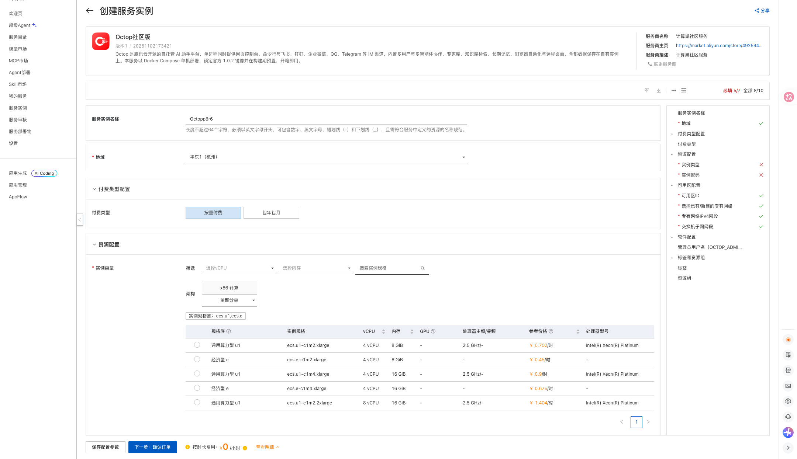
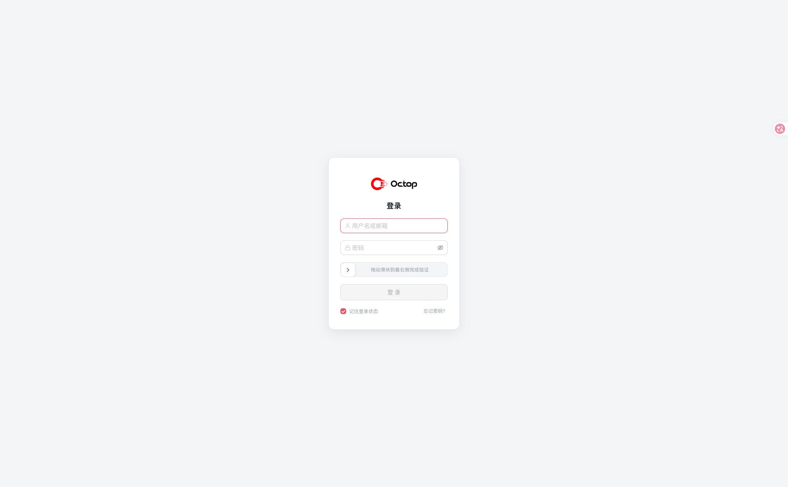

# Octop Community Edition on Compute Nest

## Overview

Octop is a self-hosted AI assistant platform. A single process exposes a web console, a CLI, and integrations with Feishu, DingTalk, WeCom and Telegram, with multi-user and multi-agent collaboration plus a local knowledge base and vector search. This Compute Nest service deploys a single ECS instance with the official Octop 1.0.2 image and Docker Compose preinstalled. All data stays on the instance.

Authentication is enabled by default; the console is reachable at port 8088 of the instance public IP.

## Billing

The template is free. Deploying an instance incurs charges for:

- ECS instance
- 200 GiB ESSD system disk (fixed by the template)
- 5 Mbps public bandwidth (fixed by the template)

## Required RAM permissions

| Policy | Purpose |
| --- | --- |
| AliyunECSFullAccess | Manage ECS resources |
| AliyunVPCFullAccess | Manage VPC resources |
| AliyunROSFullAccess | Manage ROS stacks |
| AliyunComputeNestUserFullAccess | Manage Compute Nest user resources |

## Deployment

1. Open the instance creation page, choose a region and instance type, set the instance password and the Octop administrator user name (default `admin`).

   [Deploy link](https://computenest.console.aliyun.com/service/instance/create/cn-hangzhou?type=user&ServiceId=service-8645dbd332a64e139468)

   

2. Review the price and click **Create**.

3. When deployment finishes, the **Outputs** section shows `octop_8088_url`, the administrator user name and `OctopAdminPassword`.

   

4. Open `http://<public-ip>:8088` and sign in with the administrator credentials.

   

## First use

Open the model service settings and add a provider with your API key. A DashScope (Bailian) preset pointing to `https://dashscope.aliyuncs.com/compatible-mode/v1` is built into the console.

The initial password is randomly generated and satisfies Octop's password policy (at least 8 characters, letters and digits). Change it from the avatar menu after signing in.

## Parameters

| Parameter | Description | Default |
| --- | --- | --- |
| VpcOption | NewVPC or ExistingVPC | NewVPC |
| VpcCidrBlock | CIDR of the new VPC | 192.168.0.0/16 |
| VSwitchCidrBlock | CIDR of the new vSwitch | 192.168.1.0/24 |
| EcsInstanceType | ECS instance type | none |
| InstancePassword | ECS login password | none |
| OctopAdminUsername | Octop administrator user name | admin |
| PayType | PostPaid or PrePaid | PostPaid |
| ZoneId | Availability zone | none |
| VpcId / VSwitchId | Existing VPC and vSwitch (ExistingVPC only) | empty |

## Outputs

| Output | Description |
| --- | --- |
| octop_8088_url | Octop console URL |
| OctopAdminPassword | Randomly generated initial administrator password |
| VersionInfo | Octop version information |

## Security notes

- Only port 8088 is opened in the security group.
- All `/api/` routes enforce JWT authentication; only health checks and login are public.
- The virtual desktop VNC listens on the container loopback interface only.
- Langfuse tracing is hard-disabled; no telemetry leaves the instance.
- All state is stored in `/opt/octop/data` on the system disk and is deleted with the instance.

## Known limitations

Because the console is served over plain HTTP on a public IP, four browser capabilities are unavailable: PWA installation, Passkey sign-in, voice input, and clipboard paste import on the connector page. Everything else, including copy, works normally. Configure a domain with HTTPS if you need those features.
