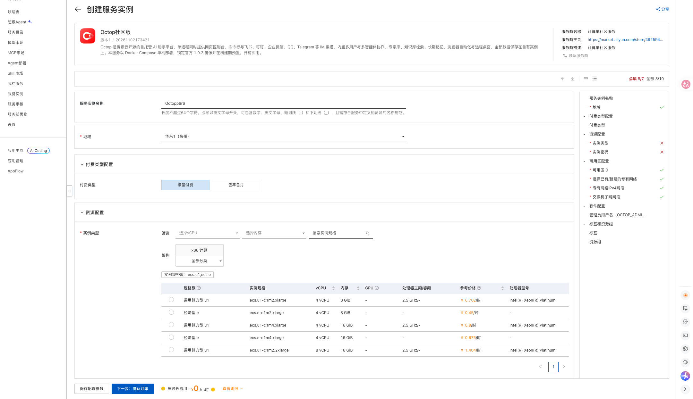
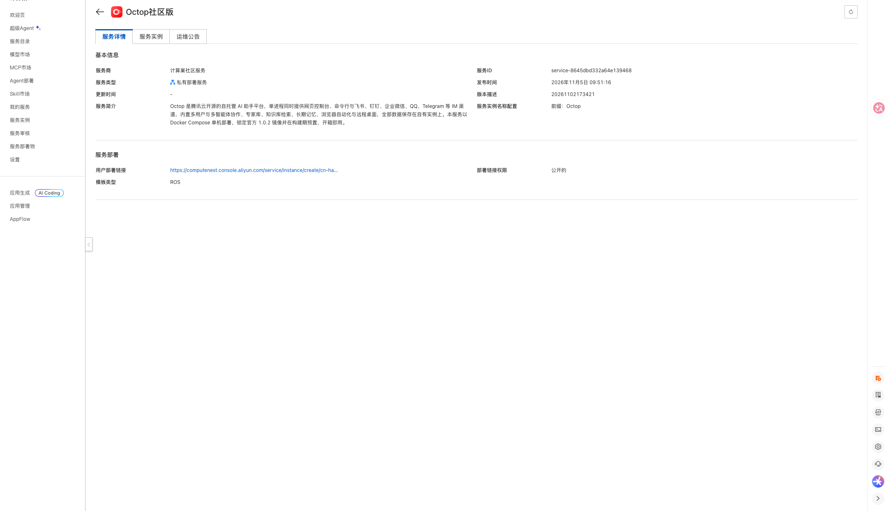
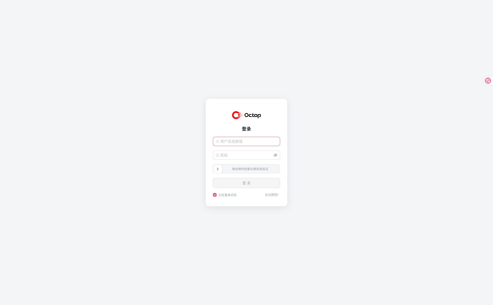

# Octop社区版计算巢部署文档

## 服务说明

Octop 是一款自托管的 AI 助手平台：单进程同时提供网页控制台、命令行以及飞书、钉钉、企业微信、Telegram 等 IM 渠道接入，内置多用户与多智能体协作、知识库与本地向量检索。本计算巢服务采用单机 ECS 部署，ECS 镜像内已预置 Octop 1.0.2 官方镜像与 Docker Compose 运行环境，数据保存在实例本机。

服务默认开启账号鉴权，访问入口为实例公网 IP 的 8088 端口。

## 计费说明

通过此服务模板构建服务不产生费用。用户部署服务实例时，资源费用主要涉及：

- ECS 实例规格
- 系统盘容量（模板固定 200 GiB ESSD）
- 公网带宽（模板固定 5 Mbps）

计费方式支持按量付费和包年包月，预估费用会在部署前实时展示。

## RAM账号所需权限

若使用 RAM 用户创建服务实例，需要在创建服务实例前为该 RAM 用户添加相应权限。

| 权限策略名称 | 备注 |
| --- | --- |
| AliyunECSFullAccess | 管理云服务器 ECS 的权限 |
| AliyunVPCFullAccess | 管理专有网络 VPC 的权限 |
| AliyunROSFullAccess | 管理资源编排 ROS 的权限 |
| AliyunComputeNestUserFullAccess | 管理计算巢服务用户侧资源的权限 |

## 服务实例部署流程

### 部署步骤

1. 打开计算巢服务实例创建页面，选择部署地域，填写实例规格、实例密码与管理员用户名（默认 `admin`）。网络可选择新建 VPC，也可以选择已有 VPC 与交换机。

   [部署链接](https://computenest.console.aliyun.com/service/instance/create/cn-hangzhou?type=user&ServiceId=service-8645dbd332a64e139468)

   

2. 确认询价明细后点击 **下一步：确认订单**，同意服务协议并点击 **立即创建**。

3. 等待服务实例部署完成。部署完成后，在服务实例详情页的 **输出** 区域查看 `octop_8088_url` 访问地址、管理员用户名与 `OctopAdminPassword` 初始密码。服务详情页信息如下：

   

4. 用浏览器打开 `http://<实例公网IP>:8088`，使用部署时填写的管理员用户名与输出中的初始密码登录。

   

## 首次使用配置

### 1. 配置大模型

登录后进入设置中的模型服务页面，添加模型 Provider 与 API Key。控制台已内置阿里云百炼预设，服务地址为 `https://dashscope.aliyuncs.com/compatible-mode/v1`。

### 2. 修改管理员密码

初始密码由系统随机生成并已通过 Octop 密码策略校验（至少 8 位且同时包含字母和数字）。登录后请在头像菜单中修改密码。

## 参数说明

| 参数 | 说明 | 默认值 |
| --- | --- | --- |
| VpcOption | 网络类型，新建 VPC 或使用已有 VPC | NewVPC |
| VpcCidrBlock | 新建 VPC 的网段 | 192.168.0.0/16 |
| VSwitchCidrBlock | 新建交换机的网段 | 192.168.1.0/24 |
| EcsInstanceType | ECS 实例规格 | 无 |
| InstancePassword | 实例登录密码 | 无 |
| OctopAdminUsername | Octop 管理员用户名 | admin |
| PayType | 付费类型 | PostPaid |
| ZoneId | 可用区 | 无 |
| VpcId / VSwitchId | 已有 VPC 与交换机 ID（选择已有 VPC 时填写） | 空 |

## 输出说明

| 输出 | 说明 |
| --- | --- |
| octop_8088_url | Octop 控制台访问地址 |
| OctopAdminPassword | 系统随机生成的管理员初始密码 |
| VersionInfo | 服务使用的 Octop 版本信息 |

## 安全与使用说明

- 服务通过公网 IP 加 8088 端口访问，安全组仅放行 8088。
- Octop 对所有 `/api/` 路由强制 JWT 鉴权，未登录时除健康检查与登录接口外一律拒绝。
- 虚拟桌面的 VNC 仅监听容器内回环地址，未对宿主机与公网开放。
- Langfuse 链路追踪总开关固定为 false，不会向外部发送遥测数据。
- 全部状态保存在系统盘 `/opt/octop/data`（挂载到容器内 `/data/.octop`），包含 SQLite 数据库、管理员账号、智能体工作区、知识库语料与本地向量模型缓存；释放服务实例会一并删除，请提前备份。

## 已知限制

访问地址为 HTTP 加公网 IP，浏览器安全上下文受限，以下四项不可用：

- 安装为桌面应用（PWA）
- Passkey 通行密钥登录
- 语音输入
- 连接器页面的剪贴板粘贴导入

复制功能与其余控制台能力正常。如需上述能力，可自行配置域名与 HTTPS 反向代理后访问。
